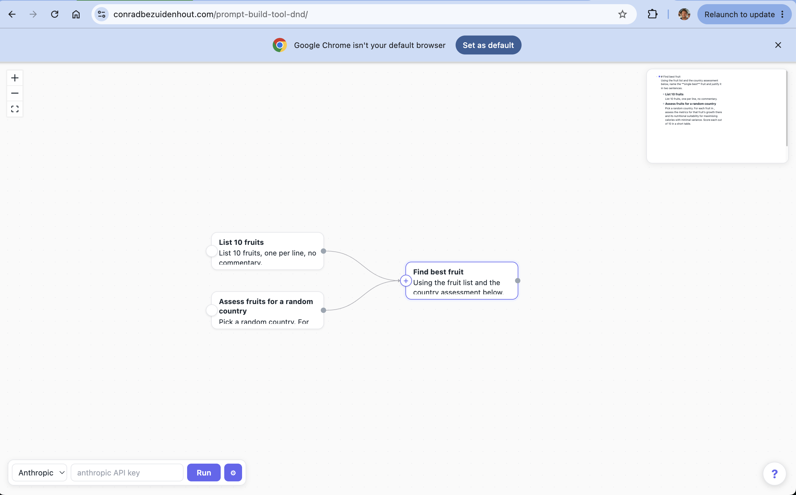
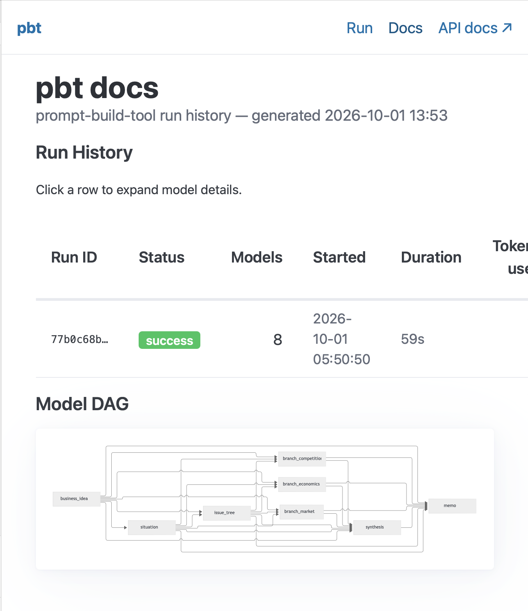

At the edge of the industrial and digital revolutions, we asked: *what do humans do?* Today, with LLMs, we are asking the same question. First, it is important to ask: **what *don't* LLMs do?**

I'm betting that humans have an intuition that LLMs lack. Something best illustrated through a mistake I made that I could easily imagine an LLM making.

# Updating the map — `promptmap test`

Large Language Model is a drunken tourist in Dublin.

We understand that we need to work off a mental map, and we need to validate that map's effectiveness against the real world. Checking our understanding against reality naturally follows a loop:
1. Have a feeling (a hypothesis).
2. Test that feeling against the real world.
3. Update the feeling.

This is best illustrated by a time this intuitive loop failed me.

On a trip through Dublin, a friend and I were walking back from a pub after a few pints, deep in conversation. Knowing I was tipsy in an unfamiliar city, I had Google Maps open and was laser-focused on following the line on the screen. To my horror, after 30 minutes of walking, my friend asked, *"Isn't this the pub we came from?"* 

In part due to the conversation, and in part due to the beers, I had turned around and spent half an hour following the gray *"this is where you have already walked"* line on the map. I wished I had used the common sense to check my surroundings against the map instead of blindly following the path on my phone. Similarly, when we design solutions we need "landmarks," "directionality," and "smoke tests" to check our direction and accuracy along the way.

So what does the intuition loop that updates our mental map look like? In Dublin, I should have periodically paused to ask myself: *"I feel like I'm walking the right way. The map shows the river on my left—let me look up and see if the river is actually there. Wait, there is no river. Now I know something is wrong."*

These checks only work if you make a prediction first. *"I expect to see the river on my left"* is a test of your intuition.

When building a complex system the journey is the human creator iterating toward a solution they trust, and `promptmap` aims to be a useful tool for the hunman to stay oriented along the way:

1. **The map** is the developer’s understanding of the problem, expressed through a DAG of models (`promptmap models`).
2. **A step** is a change to a prompt, assumption, component, or connection (`promptmap run`).
3. **A landmark** is an expectation that lets the developer check whether that step moved them in the right direction.
4. **Tests** preserve those expectations across iterations (`promptmap test`).

`promptmap test` is a structured way for humans to look up from the screen and spot those landmarks as we develop our map of models. Tests check what we expect to get out, making sure the map’s intuition still holds against reality.

# Creating and exploring the map — `promptmap models`, `docs`, and `serve`

If `promptmap test` provides the landmarks, `promptmap models` is the map itself—holding both the destination and the divergent roads leading there. `promptmap` gives your mental model of a problem a natural resting place, much like a paper map helps build a picture in your head of the streets ahead and gives you landmarks to orient yourself against the real world.

A fitting analogy comes from physics class, where I was told never to erase incorrect working, but rather to build off it and use it to navigate closer to the correct answer. If we treat a prompt as a single pass/fail one-shot, we lose the contextual journey and struggle to orient ourselves toward the destination. At the same time, if we mindlessly save every prompt variation in a flat folder, we end up in chaos—something akin to trying to use a *"101 Sights to See in Dublin"* brochure to navigate the streets.

This is where `promptmap docs` and `promptmap serve` come in—turning your prompt pipeline into a living, visual map you can inspect and manipulate through the drag-and-drop companion to `promptmap`:



Each model is a hypothesis connected to higher- and lower-order hypotheses, forming a complete map of the problem at hand. Adjusting an outcome might require testing a tweak at a lower level or accounting for drift in an underlying assumption, but it should *never* require a blind, one-shot rewrite. Tweaking the graph to fit the intuitive map in *our* heads—and verifying it against real-world landmarks—is the secret sauce to unlocking LLM productivity.



**TL;DR:** Below is a concrete, punchy closing section for `motivation.md` that uses the exact directory structure from your screenshot (`1_design`, `2_build`, `3_qa`, and `tests/reversed_flyback_diode.yml`) to bring the "map and landmarks" philosophy to life. *(Also caught a tiny typo in your draft above: `hunman` → `human`, and `Large Language Model is` → `My Large Language Model is`).*

---

### Drop-in Section for the Bottom of `motivation.md`

```markdown
# Example: An automated PCB design pipeline

To see how the map and landmarks work together in practice, consider an automated [PCB design project](./examples/pcb_design) structured as a `promptmap` DAG:


```text
pcb_design/
├── models/
│   ├── 1_design/        # 1_a_brief -> 1_b_requirements -> 1_c_architecture -> 1_d_electrical_check
│   ├── 2_build/         # 2_a_parts -> 2_b_research -> 2_c_layout_rules -> 2_d_board
│   └── 3_qa/            # 3_a_bom_line, 3_b_polarity, 3_c_bringup -> 3_d_review
└── tests/
    └── reversed_flyback_diode.yml

```

1. **The Map (`models/`):** Instead of asking an LLM to "design a PCB" in one massive prompt, the problem is broken into stages (`1_design`, `2_build`, `3_qa`). Each `.prompt` file is a hypothesis that feeds downstream via `ref()`—from initial architecture (`1_c_architecture.prompt`) to physical board generation (`2_d_board.prompt`) and QA (`3_b_polarity.prompt`).
2. **The Mistake (Drifting off the map):** During iteration, the pipeline generated a board where a flyback diode's logical net names looked right, but its physical pad connections were reversed—a classic LLM blind spot that would fry the board on bring-up.
3. **Updating the Map (`3_b_polarity.prompt`):** Instead of rewriting the whole pipeline from scratch, we update a specific node in the graph (`2_b_research.prompt` or `3_b_polarity.prompt`) to explicitly cross-check datasheet pin-to-pad mappings against cathode/anode orientation.
4. **Preserving the Landmark (`tests/reversed_flyback_diode.yml`):** Finally, we lock in that hard-won lesson as a test:

> *"I discovered that correct logical pin names don’t guarantee correct physical pad connections. I’ve changed my process to account for that. `reversed_flyback_diode.yml` checks that my pipeline still catches this mistake as I keep iterating."*

Now, whenever we tweak upstream prompts in `1_design` or `2_build`, running `promptmap run && promptmap test` verifies that our mental map still holds against reality.
